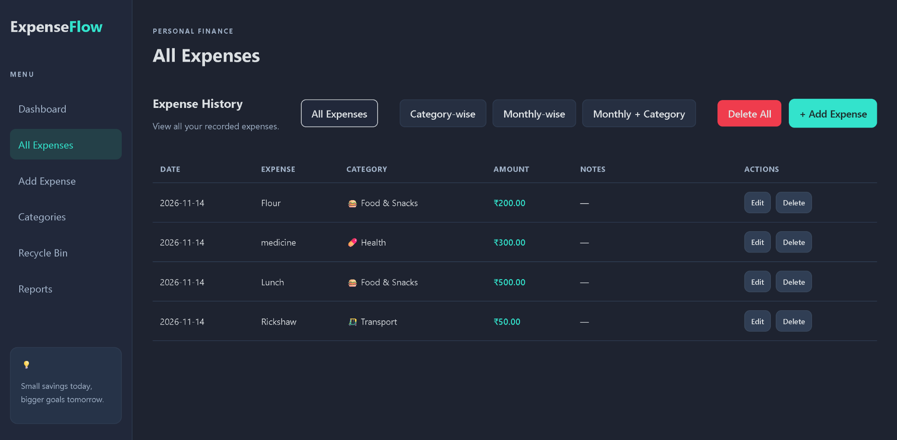
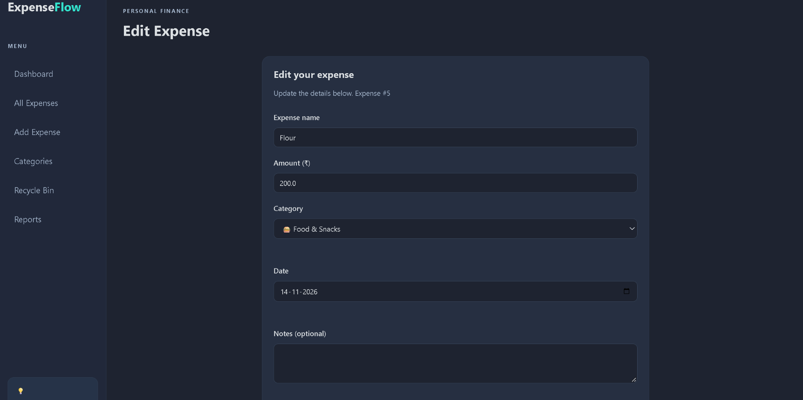
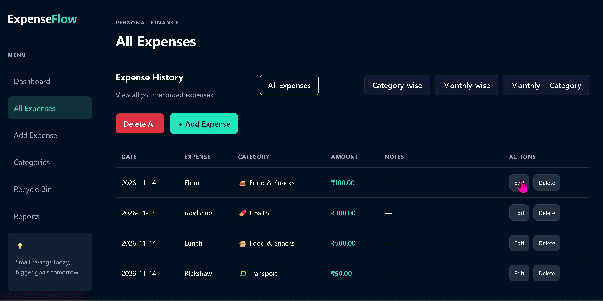
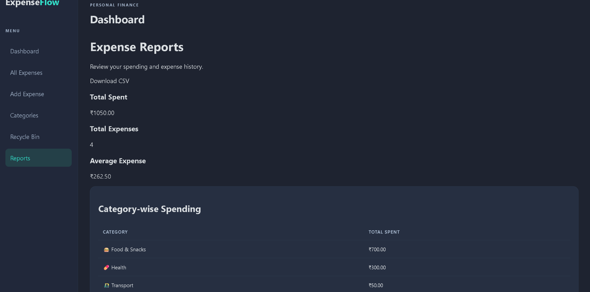

# Personal Expense Tracker

**SEC101 — MCA Group Assignment | Advanced Tools and Applications**  
**Topic:** Project Development Using Git, GitHub and Markdown  
**Repository:** [Ravi-14042023/expense-tracker-web-project](https://github.com/Ravi-14042023/expense-tracker-web-project)

## Project Description

**ExpenseFlow** is a personal expense-tracking web application built using **Python, Flask and SQLite**. It allows a user to record expenses in Indian rupees (₹), view expense history, edit entries, organise spending into categories, recover deleted expenses, review spending summaries and export records to CSV.

This project was developed by two MCA students using separate Git branches, meaningful commits, peer-reviewed pull requests and merge-conflict resolution.

## Project Objectives

- Create a functional expense-management web application.
- Organise and maintain expense records using SQLite.
- Provide expense editing, category summaries, month-wise views and CSV export.
- Support soft deletion and recovery through the Recycle Bin.
- Practise **Git, GitHub, branching, merging, pull requests, code review and Markdown documentation**.

## Team Members and Individual Contributions

| Role | Name | Roll number | GitHub account | Branch | Main contribution |
| --- | --- | --- | --- | --- | --- |
| Student 1 / Owner | **Ravindra Kilaniya** | **48** | [Ravi-14042023](https://github.com/Ravi-14042023) | `feature-member1` | Expense reports, month/category summaries, CSV export and related fixes |
| Student 2 / Collaborator | **Tejaswi Rawal** | **61** | [Tejaswi-06-24](https://github.com/Tejaswi-06-24) | `feature-member2` | Edit Expense form and controls, Restore All, related tests and merge-conflict resolution |

The contributions and review workflow are described in [CONTRIBUTING.md](CONTRIBUTING.md).

## Main Features

| Feature | Description |
| --- | --- |
| **1. Add Expenses** | Record a title, positive amount, category, date and optional notes. |
| **2. All Expenses** | View expense history and summary views grouped by category, month, or both. |
| **3. Edit Expense** | Update an existing active expense without creating another record. |
| **4. Delete Expenses** | Move individual expenses or all active expenses to the Recycle Bin. |
| **5. Restore Expenses** | Recover individual deleted expenses or use **Restore All** to recover all soft-deleted records. |
| **6. Categories** | Create categories and archive or restore category entries. |
| **7. Reports** | View total spending, number of expenses, average spending and category-wise totals. |
| **8. CSV Export** | Download active expense records as a CSV file. |

> Deleting an expense normally performs a **soft delete**: the record remains in SQLite until it is permanently deleted from the Recycle Bin.

## Technologies Used

| Technology | Purpose |
| --- | --- |
| Python | Server-side application logic |
| Flask | Web framework and request routing |
| SQLite | Persistent local database for expenses and categories |
| HTML and Jinja templates | Web pages and form rendering |
| CSS | Interface styling |
| JavaScript | Client-side interactions |
| Git | Version control, commits and merges |
| GitHub | Hosting, collaboration, pull requests and code reviews |
| Markdown | Project and contribution documentation |

## Project Structure

```text
expense-tracker-web-project/
├── app.py                      # Flask routes and application logic
├── database.py                 # SQLite connection and initialisation
├── requirements.txt            # Python dependencies
├── .gitignore                  # Local files excluded from Git
├── README.md                   # Project documentation
├── CONTRIBUTING.md             # Team workflow and individual contributions
├── static/
│   ├── css/                    # Web interface styles
│   └── js/                     # Client-side scripts
├── templates/                  # HTML/Jinja pages (including edit and recycle bin)
├── tests/                      # Tests for contributed features
└── screenshots/                # Application screenshots and the GIF asset
    ├── expense-list.png
    ├── edit-expense.png
    ├── reports.png
    └── expense-interaction.gif
```

The SQLite file `expenses.db` is created locally when needed and should not be committed.

## Installation and Execution

### 1. Clone the repository

```bash
git clone https://github.com/Ravi-14042023/expense-tracker-web-project.git
cd expense-tracker-web-project
```

### 2. Create a Python virtual environment

```bash
python -m venv .venv
```

**Windows PowerShell:**

```powershell
.\.venv\Scripts\Activate.ps1
```

**Linux/macOS:**

```bash
source .venv/bin/activate
```

### 3. Install dependencies

```bash
python -m pip install -r requirements.txt
```

### 4. Start the application

```bash
python app.py
```

Open **http://127.0.0.1:5000** in a web browser. The application initialises its SQLite tables and default categories during startup.

### 5. Run automated tests

If the `tests` directory is available in your checkout:

```bash
python -m unittest discover -s tests -v
```

## How to Use the Application

1. Open **Add Expense** and enter the title, amount, category and date.
2. Open **All Expenses** to view records, filter or select **Edit** beside a record.
3. To change a record, update its details in **Edit Expense** and save.
4. Select **Delete** to move a record into the **Recycle Bin**.
5. In **Recycle Bin**, use **Restore** on an individual record or **Restore All** to recover every deleted record.
6. Open **Reports** to review totals and category-wise spending, or use **Download CSV** to export data.

## Application Screenshots

These images were captured from the running application.

### A. All Expenses — expense list and Edit buttons



### B. Edit Expense form



### C. Interface capture (GIF asset)



### D. Reports and CSV export



## Git and GitHub Collaboration

The project uses two feature branches and two reviewed pull requests:

| Pull request | Contributor | Reviewer | Scope |
| --- | --- | --- | --- |
| [PR #1 — Expense reports and CSV export](https://github.com/Ravi-14042023/expense-tracker-web-project/pull/1) | Ravindra Kilaniya | Tejaswi Rawal | Reports, filters and CSV export |
| [PR #2 — Edit Expense and Restore All](https://github.com/Ravi-14042023/expense-tracker-web-project/pull/2) | Tejaswi Rawal | Ravindra Kilaniya | Editing form, Restore All and tests |

The students also changed the same Flask initialisation line in `app.py` on different feature branches to demonstrate a **real merge conflict**. The conflict was resolved collaboratively and recorded in commit [`002fcd6`](https://github.com/Ravi-14042023/expense-tracker-web-project/commit/002fcd6).

To display the project's commit graph locally:

```bash
git fetch origin
git log --oneline --graph --all
```

## Documentation and Safety Notes

- [Contribution guide and code reviews](CONTRIBUTING.md)
- [Pull Request #1](https://github.com/Ravi-14042023/expense-tracker-web-project/pull/1)
- [Pull Request #2](https://github.com/Ravi-14042023/expense-tracker-web-project/pull/2)
- Do not commit passwords, API keys, virtual environments or the local `expenses.db` file.
- The current Flask secret key and debugging settings are development-only; change them before any public deployment.


